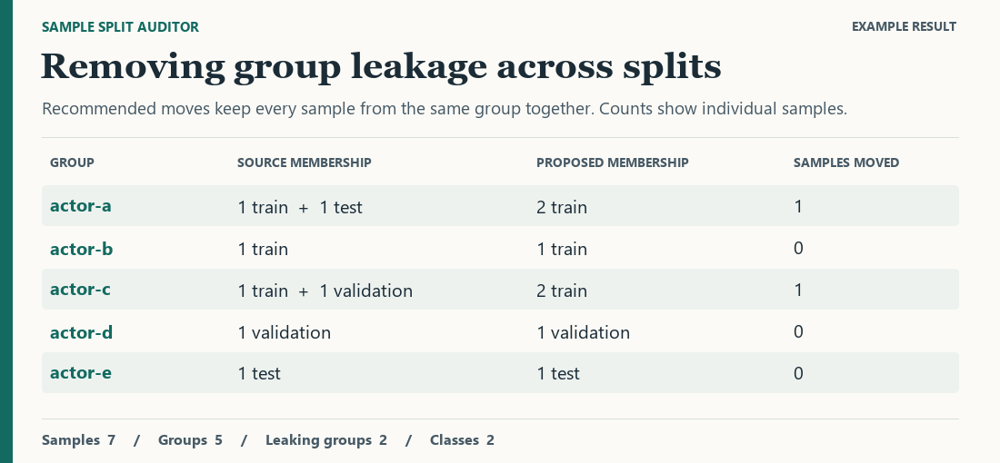
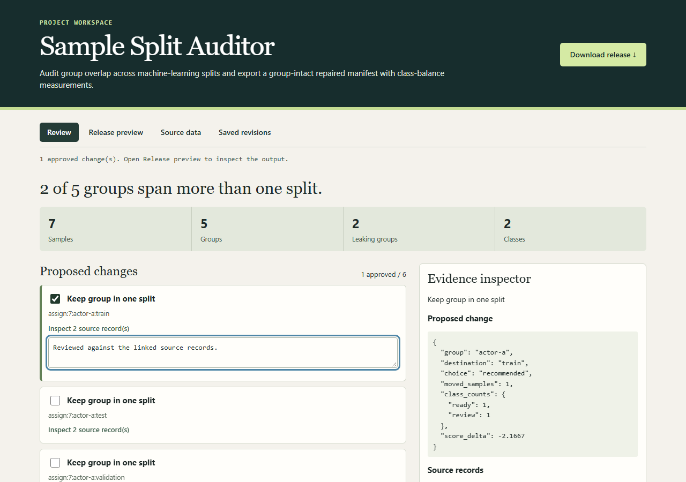

# Sample Split Auditor

Audit group overlap across machine-learning splits and export a group-intact repaired manifest with class-balance measurements.

**[Open the live demo](https://oguzhanozfe.github.io/sample-split-auditor/)** · [](https://github.com/oguzhanozfe/sample-split-auditor/actions/workflows/check.yml) · [Deploy to Render](https://render.com/deploy?repo=https://github.com/oguzhanozfe/sample-split-auditor) · [Input guide](GUIDE.md)

Samples from the same actor appear in training and evaluation. Regroup the records, then inspect what the repair does to class proportions.



The live demo lets you edit the input, search proposed changes with an on-device model and download the result. [Browser demo details](demo/DEMO.md)

## Try it

With Python 3.11+ installed, clone this repository and run:

```sh
git clone https://github.com/oguzhanozfe/sample-split-auditor.git
cd sample-split-auditor
python app.py
```

Open <http://127.0.0.1:8000>. The synthetic example is loaded. Select a proposed change, inspect its source records, and open **Release preview** to see the resulting files. Choose **Download release** to save them.

## Walk through the example

Use stable sample IDs, group identifiers, one class label per sample and the current split. A group might be a participant, recording session, household or source document. Choose it according to the leakage mechanism. Target fractions must sum to one. Keep the source table immutable and apply the exported manifest in the training pipeline.

**What the engine finds.** 2 of 5 groups span more than one split.

**Try this decision.** Approve **Keep group in one split**. The [example review](docs/example-review.json) lists the supporting record IDs and the checksum of each exported file. Its native outputs are [`split-manifest.csv`](docs/example-release/split-manifest.csv), [`stratification.csv`](docs/example-release/stratification.csv), [`quarantined-groups.json`](docs/example-release/quarantined-groups.json).

Reproduce that release at the command line:

```sh
python app.py analyze example.json
python app.py export example.json --approve "assign:7:actor-a:train" --out reviewed.zip
```

## Model-assisted review

With a local model in Ollama or LM Studio, Azure OpenAI, Amazon Bedrock, or a compatible API connected, select **Request suggestions**. The model examines up to eight candidate actions. Each displayed suggestion links to one of that action's source records. Approving a change and recording a review note remain explicit reviewer actions.

The app runs locally with Python's standard library. The Docker image includes the Bedrock SDK and the production web server. The same UI can save immutable revisions, reopen a workspace and compare decisions. See [model settings, Docker deployment and the HTTP API](docs/deployment.md).



## Development

The domain algorithm and exporter live in [pipeline.py](pipeline.py). The [method guide](GUIDE.md) describes its input assumptions and limitations. Install test dependencies and run the suite:

```sh
python -m pip install -r requirements.txt
python -m unittest discover -v
```

[MIT license](LICENSE)
